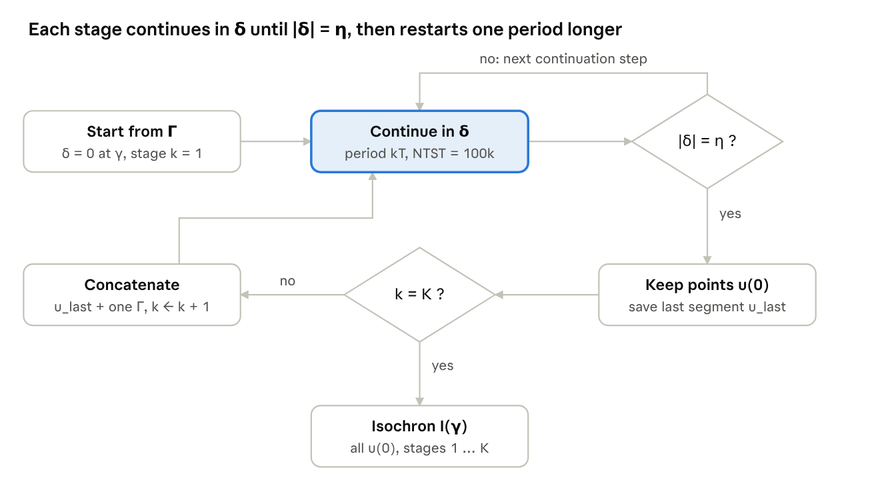

This recipe lists every calculation needed to reproduce the global isochrons of the reduced
Hodgkin-Huxley model (the paper's Figures 2 and 3, and notebook 02_ISOCHRONS_continuation).
Each step has the same number as a `STEP` comment in `reproduce_isochrons.py`, which does
exactly this with XPPAUT 8.2 and its AUTO through pyauto-xpp.

# Installation

pyauto-xpp is installed from the prebuilt wheels on its GitHub release. Wheels exist for
Linux (x86_64, aarch64), macOS (Intel and Apple Silicon) and Windows, for Python 3.10 to 3.15.
Nothing else is needed: no X11, no compiler and no separate XPPAUT. In a terminal:

```
python3 -m venv isochron-env                # a separate Python environment
source isochron-env/bin/activate            # Windows: isochron-env\Scripts\activate
pip install pyauto-xpp numpy matplotlib tqdm \
    --find-links https://github.com/ZetaOne/pyauto-xpp/releases/expanded_assets/v0.3.0
python -c "import pyxpp; print('pyauto-xpp is installed')"
```

`tqdm` draws the progress bars and `matplotlib` the figures. In a conda environment, the same
`pip install` line works after `conda activate <env>`.

**On macOS** the commands are the same, in Terminal. The one thing to check first is
`python3 --version`: it must be 3.10 or newer. Apple's own `python3` (from the Xcode
command-line tools) is 3.9, for which there is no wheel, and `pip` then fails. Install a newer
Python from [python.org](https://www.python.org/downloads/macos/) or with Homebrew
(`brew install python@3.12`, then use `python3.12 -m venv isochron-env`), or use a conda
environment. Apple Silicon and Intel Macs both get a prebuilt wheel.

**If pyauto-xpp was installed with pixi** (the project's `git clone` + `pixi run lab` route),
use that environment instead of a venv. Activate it in a terminal, then run the scripts from
any folder:

```
cd pyauto-xpp && pixi shell          # this terminal now uses the project's environment
cd ~/isochron-scripts                # wherever reproduce_isochrons.py was saved
python reproduce_isochrons.py --quick
```

`exit` leaves the pixi shell. The pixi environment needs `tqdm`: it is included in pyauto-xpp
from the version after 0.3.0; with an older clone, run `pixi add tqdm` once in the `pyauto-xpp`
folder.

# Running it

```
python reproduce_isochrons.py                # the paper: 100 isochrons, Figures 2 and 3
python reproduce_isochrons.py --workers 8    # the same, 8 isochrons at a time
python reproduce_isochrons.py --quick        # only the 0-phase isochron, about 5 minutes
python reproduce_isochrons.py --no-show      # save the figures without opening windows
```

* **Defaults:** the paper's settings, which are 100 phases θ_i = i/100, 4 stages inside
  the orbit and 1 outside.
* **Run time:** all 100 isochrons take about 4.5 hours on one core. With `--workers N` the
  phases run N at a time, one XPPAUT per process, so the run is about N times faster.
* **Progress bars:** they show the isochrons done, and the stages of the current one.
* **Resuming:** finished isochrons are skipped on a rerun, so an interrupted run carries on.

Results go to `isochron_results/`:

| File | Contents |
|---|---|
| `figure2_all_isochrons.png` | the paper's Figure 2: all isochrons, coloured by phase |
| `figure3_zero_phase.png` | the paper's Figure 3: (a) the 0-phase isochron, (b) n against arclength, (c) near the equilibrium |
| `isochron_<θ>.dat` | the points of each isochron: V, n, δ, stage, side (−1 inside, +1 outside) |
| `isochron_<θ>.log` | what each stage did |
| `orbit.dat` | the orbit Γ |
| `odes/reduced_hh.ode` | the model (steps 1–3) |
| `odes/isochron_<θ>_<in or out>_k<k>.ode` | the boundary value problem of every stage, with per = kT and γ, n_s filled in, ready for XPPAUT |

# Overview

| Step | What is computed | Tool | Result |
|---|---|---|---|
| 1 | the model | XPP .ode | right-hand sides F(V, n) |
| 2 | the orbit, its period, phase zero | XPP integration, Initialconds > Periodic | Γ, T, γ0 |
| 3 | the isochron's direction on Γ | XPP adjoint (Numerics > Averaging > New adj) | n_s(θ) |
| 4 | the boundary value problem | XPP .ode with `bndry` lines | BVP file |
| 5 | start a stage | AUTO, Bdry Value start | first solution of the stage |
| 6 | choose the direction | 25 AUTO steps each way | inside / outside, extend / go back |
| 7 | follow the family | AUTO continuation in δ until \|δ\| = η | isochron points u(0) |
| 8 | start the next stage | concatenation, eq. (3.5) | starting solution of stage k + 1 |
| 9 | all phases, save, plot | loop over θ | isochron_θ.dat, isochrons.png |

{width=95%}

# Step 1. The model

The reduced Hodgkin-Huxley equations, the paper's eq. (4.1):

$$
\begin{aligned}
\dot V &= I - g_{Na}\, m_\infty(V)^3 (0.8 - n)(V - E_{Na}) - g_K\, n^4 (V - E_K) - g_L (V - E_L),\\
\dot n &= \alpha_n(V)(1-n) - \beta_n(V)\, n
\end{aligned}
$$

$$
\alpha_m = \frac{0.1(V+40)}{1 - e^{-(V+40)/10}},\qquad
\beta_m = 4 e^{-(V+65)/18},\qquad
m_\infty = \frac{\alpha_m}{\alpha_m+\beta_m}
$$

$$
\alpha_n = \frac{0.01(V+55)}{1 - e^{-(V+55)/10}},\qquad
\beta_n = 0.125\, e^{-(V+65)/80}
$$

| I | g_Na | g_K | g_L | E_Na | E_K | E_L |
|---|---|---|---|---|---|---|
| 10 | 120 | 36 | 0.3 | 50 | −77 | −54.4 |

Integrator for everything that is integrated: classical Runge-Kutta (XPP `meth=rk4`).

# Step 2. The orbit Γ, the period T, and γ0

1. Integrate from (V, n) = (−60, 0.3) for 300 time units, so the trajectory settles on Γ.
2. XPP Initialconds > Periodic (with V as the plotted variable) returns the period T.
3. Phase 0 is the point γ0 where V is largest. There V' = 0, so find it by bisection on
   the time t in [T − 0.05, T + 0.05] for the sign change of V'. Forty halvings give
   double precision.
4. Store one period of Γ from γ0 (time step 0.001); it is used to tell inside from outside.

**Check:** T = 11.8463 and γ0 = (44.7064, 0.4597).

# Step 3. The direction n_s of the isochron at γ(θ)

1. From γ0, run XPP's adjoint (Numerics > Averaging, grid 6400, New adj). It gives
   Z(t) = (Z_V, Z_n) along Γ, the gradient of the asymptotic phase.
2. For a phase θ: γ(θ) = Φ(θT, γ0) by integration (step at most 10⁻⁴), and
   Z = Z(θT) by interpolation.
3. The isochron is perpendicular to Z: n_s = (Z_n, −Z_V) / |Z|. Orient it to point out of
   Γ: flip the sign if F(γ) × n_s > 0 (Γ runs counter-clockwise).

**Check:** at γ0, n_s = (0.99999999, −0.00013711) (pointing out of Γ, up to sign).

# Step 4. The boundary value problem

Orbit segments u(s), 0 ≤ s ≤ 1, that take k periods and end on the short segment
L_η = {γ + δ n_s, |δ| ≤ η}:

$$
\frac{du}{ds} = kT\, F(u), \qquad u(1) = \gamma + \delta\, n_s, \qquad u(0)\ \text{free}
$$

As an XPP file (values for θ = 0; `v'` in a `bndry` line means v at s = 1):

```
v'=per*(iapp-gna*minf(v)^3*(0.8-n)*(v-ena)-gk*n^4*(v-ek)-gl*(v-el))
n'=per*(an(v)*(1-n)-bn(v)*n)
par per=11.846275031,gv=44.70638155,gn=0.45973602
par tv=0.999999991,tn=-0.000137107891,d=0
bndry v'-gv-d*tv
bndry n'-gn-d*tn
@ total=1,dt=0.0001,meth=rungekutta
```

`per` = kT, (gv, gn) = γ, (tv, tn) = n_s, d = δ. Two equations, two boundary conditions, one
free parameter d: a one-parameter family. **The u(0) of every member is an isochron point.**

AUTO constants (the paper's Table 1, as used here):

| NTST | NCOL | IAD | EPSL, EPSU | EPSS | ITNW | NWTN | ITMX | DS | DSMIN | DSMAX | η |
|---|---|---|---|---|---|---|---|---|---|---|---|
| 100 k | 4 | 3 | 10⁻⁸ | 10⁻⁶ | 5 | 3 | 8 | 10⁻⁵ | 10⁻⁸ | 0.1 | 10⁻⁴ |

# Step 5. Start a stage

* **Stage 1 starting solution:** Γ itself from γ over one period, with δ = 0. Integrate the
  BVP's equations with per = T from u(0) = γ over s ∈ [0, 1].
* **Bdry Value start:** run AUTO from this solution with d as the continuation parameter.
  XPP's AUTO puts the starting solution on a uniform mesh, and the first Newton steps then
  move δ away from 0, so:
  1. Take 6 steps with δ unbounded and DSMAX = 10⁻⁶. The mesh adapts (IAD = 3) and δ
     returns to about 10⁻¹⁰.
  2. Accept the start if all 6 steps converged and |δ| < η/10 at the last one.
  3. Otherwise retry with ITNW = 20, then with NTST doubled, then with NTST × 4.
* The last of the 6 points is the start of the stage.

# Step 6. Choose the direction

Along most of the family δ changes by about 10⁻²⁰, far below the discretisation error, so
the sign of DS does not fix the direction. Probe both ways (25 steps, 150 if undecided):

* **Stage 1:** keep the way whose last points lie inside Γ (inside branch) or outside
  (outside branch).
* **Stage k > 1:** one way goes back over stage k − 1, the other extends the isochron.
  Compute δ′ = (u((k − 1)/k) − γ) · n_s, the position one period before the segment's end.
  Keep the way where |δ′| grows.

# Step 7. Follow the family

Continue from the probe in the chosen direction, with bounds −η ≤ δ ≤ η, so AUTO stops when
|δ| reaches η (one step beyond at most). Record u(0) and δ of every point.

* **Inside branch:** at most 5000 points per stage.
* **Outside branch:** |δ| may never reach η, because the contraction is too strong.
  Continue 100 points at a time until u(0) leaves −150 < V < 150, 0.15 < n < 0.95.

# Step 8. Start the next stage: concatenation (eq. 3.5)

Take u_last, the last solution of stage k − 1 (it lasts k − 1 periods and ends at the end
of L_η). Append one period of Γ from γ, rescale to [0, 1], set per = kT and NTST = 100k:

$$
u(s) = \begin{cases} u_{last}\!\left(\tfrac{k}{k-1}\, s\right), & 0 \le s \le \tfrac{k-1}{k} \\[3pt] u_\Gamma\big(ks - (k-1)\big), & \tfrac{k-1}{k} < s \le 1 \end{cases}
$$

Sample it on 4000k + 1 points, then repeat steps 5 to 7 with it as the starting solution.
Do stages k = 1, …, 4 inside Γ and stage 1 outside.

# Step 9. All phases, saving, plotting

For θ_i = i/100, i = 0, …, 99, repeat steps 3 and 5 to 8, using the same BVP model with new
values of gv, gn, tv, tn. Save the u(0) points of each stage:

```
isochron_<theta>.dat:   V   n   delta   stage   side      (side −1 inside Γ, +1 outside)
```

Plot all isochrons with Γ and the nullclines V′ = 0, n′ = 0 (the paper's Figure 2).

# What you should get (the 0-phase isochron)

| Quantity | Paper | This recipe |
|---|---|---|
| T | 11.8463 | 11.846275 |
| γ0 | (44.7064, 0.4597) | (44.706382, 0.459736) |
| points per stage inside (k = 1, 2, 3, 4) | | 718, 808, 751, 677 |
| NTST used to start each stage | 100 k | 100, 200, 1200, 400 |
| δ at the end of each stage | ±η | about −1.0 × 10⁻⁴ |
| top of the 1st and 2nd excursion, n | 0.6802, 0.5517 | 0.68028, 0.55172 |
| excursions and boomerang turns up to 4T | 3 and 3 | 3 and 3 |
| time | | about 5 minutes |

For all 100 isochrons, 465 of the 500 stages start with the paper's NTST and ITNW. The rest
need ITNW = 20 or a finer mesh (step 5).

**Consistency check.** Isochrons must not cross. Neighbouring isochrons only appear to cross
where they run within about 10⁻⁴ mV of each other, along the repelling slow manifold. There
the phase is so sensitive that a move of 10⁻⁴ mV changes it by about 0.1.
